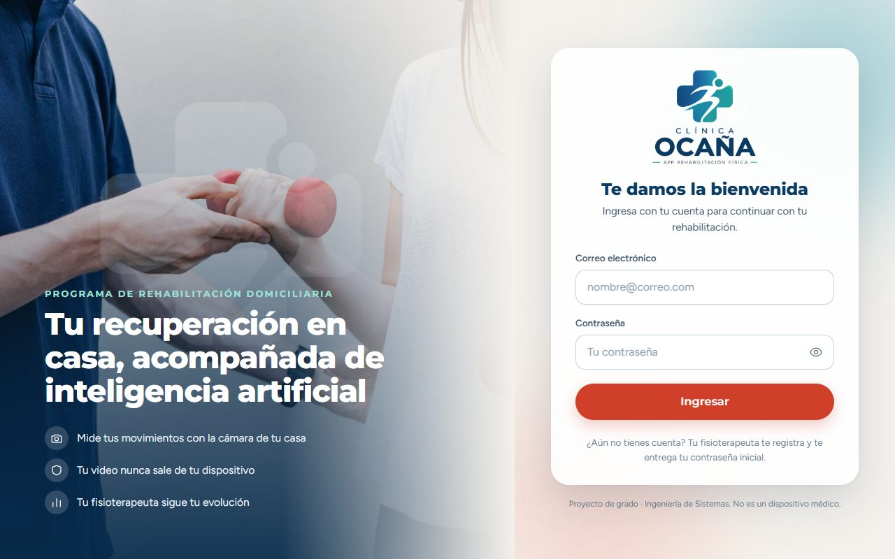
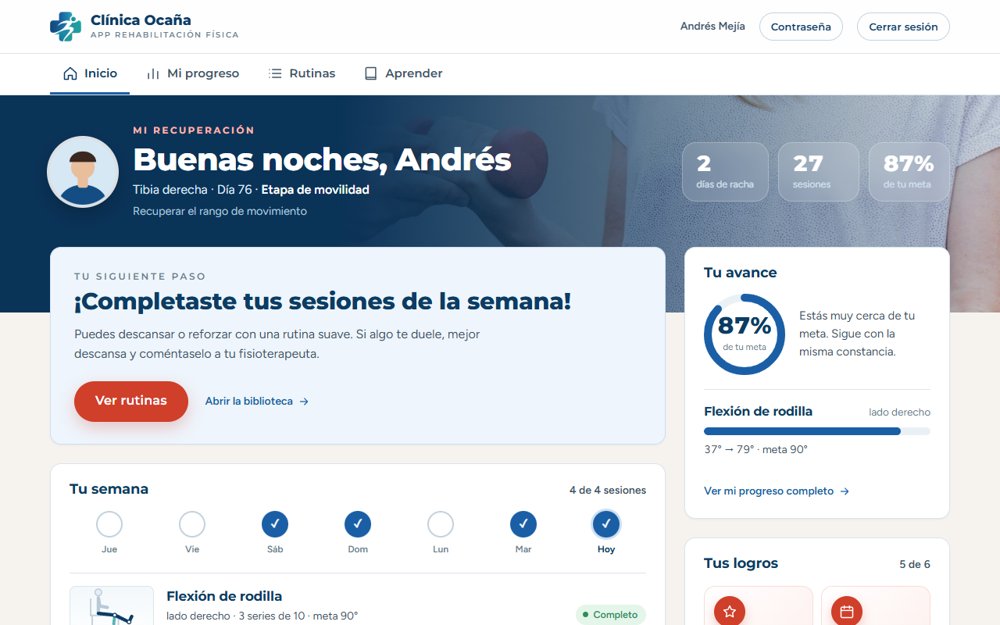
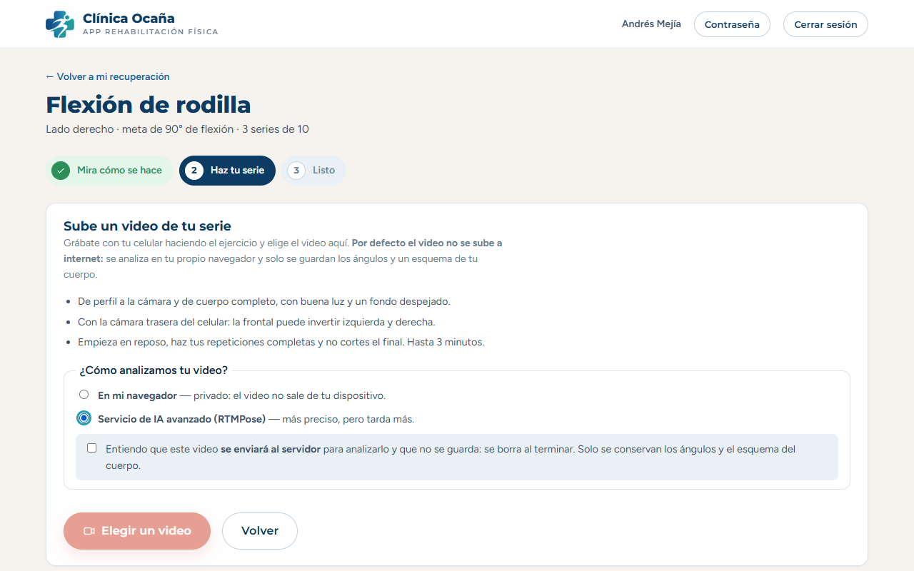
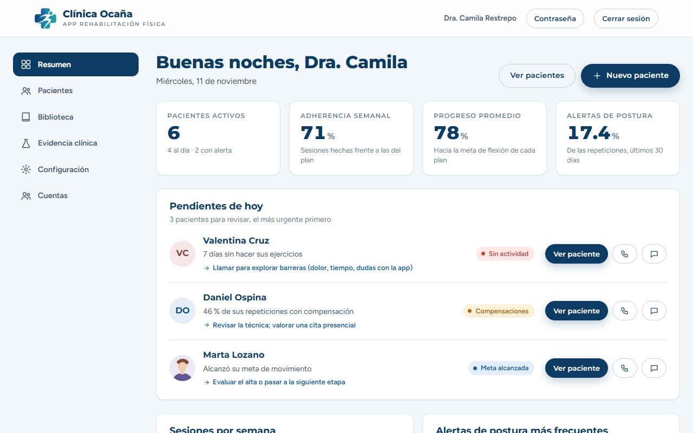
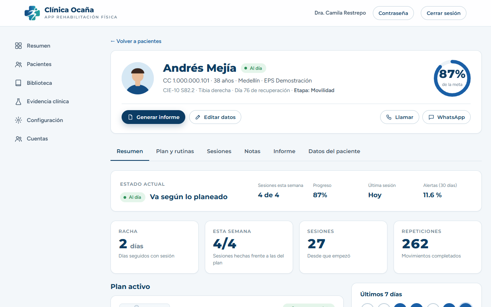
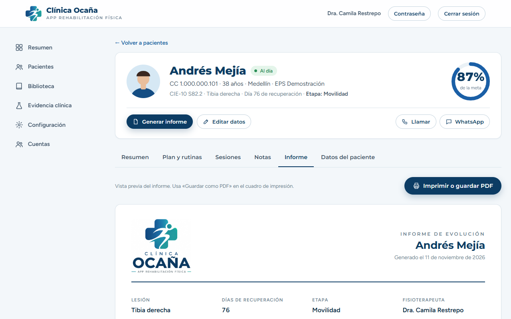

# Telerehabilitación asistida por IA — recuperación de fracturas

Plataforma web para que pacientes en recuperación de una fractura hagan sus ejercicios en casa frente a la cámara, y para que su
fisioterapeuta siga la evolución de todos ellos desde un panel. El sistema **estima el ángulo articular, cuenta repeticiones y detecta
compensaciones de postura** con visión por computador, y convierte esos datos en alertas, estadísticas y un informe imprimible.

Proyecto de grado — Ingeniería de Sistemas. Autor: **Juan David Amaya , Nicolas Rodriguez**.

> **Aviso importante.** Esto es un proyecto académico, **no un dispositivo médico**. Las mediciones con cámara son estimaciones con margen
> de error y no reemplazan el goniómetro ni la valoración del fisioterapeuta. Todos los datos incluidos son **ficticios**: no lo uses con
> pacientes reales sin revisión jurídica (ver `docs/CONSIDERACIONES-COLOMBIA.md`). La validación de la exactitud contra goniómetro está
> **diseñada pero aún no ejecutada** (ver `docs/PROTOCOLO-VALIDACION-GONIOMETRO.md`).

## Contenido

- [Capturas](#capturas)
- [Qué hace](#qué-hace)
- [Qué necesitas instalar](#qué-necesitas-instalar)
- [Inicio rápido (Windows)](#inicio-rápido-windows)
- [Instalación manual](#instalación-manual-windows-linux-o-mac)
- [Cuentas y primer ingreso](#cuentas-y-primer-ingreso)
- [Cómo se usa](#cómo-se-usa)
- [Servicio de pose (opcional)](#servicio-de-pose-opcional)
- [Configuración](#configuración)
- [Pruebas](#pruebas)
- [Arquitectura y estructura](#arquitectura-y-estructura)
- [Documentación](#documentación)
- [Estado y limitaciones](#estado-y-limitaciones)
- [Solución de problemas](#solución-de-problemas)

## Capturas

| Ingreso | Inicio del paciente |
|---|---|
|  |  |

| Subir un video de la serie | Panel del fisioterapeuta |
|---|---|
|  |  |

| Ficha del paciente | Informe de evolución |
|---|---|
|  |  |

## Qué hace

**Para el paciente**
- Ve su plan de la semana, su progreso hacia la meta y sus logros.
- Hace el ejercicio con la cámara: el sistema mide el ángulo en vivo, cuenta repeticiones y avisa de la postura. O **sube un video** ya grabado.
- Recibe recomendaciones explicables («¿por qué me lo dices?») y una biblioteca educativa con rutinas.

**Para el fisioterapeuta**
- Panel con pacientes activos, adherencia, progreso y alertas priorizadas.
- Ficha completa del paciente (datos colombianos, autorización de datos personales), prescripción de planes y rutinas, notas clínicas.
- Cada sesión con su análisis (cansancio, ritmo, postura) y un **replay del movimiento como muñeco**, sin ver a la persona.
- Sugerencias del asistente que **él decide** aplicar, e informe imprimible a PDF con un resumen redactado por reglas.

**Para el administrador** (un fisioterapeuta con permiso extra): crea, desactiva y restablece cuentas de fisioterapeutas.

**Decisiones de diseño**
- **Privacidad:** la guía en vivo usa MediaPipe **en el navegador**: el video no sale del dispositivo. El análisis con un modelo más pesado
  (RTMPose, en el servidor) es opcional y pide consentimiento explícito; el video no se guarda.
- **Explicable:** el ángulo se calcula con geometría, y las recomendaciones y el informe son **reglas**, no un modelo generativo.
- **Seguridad:** contraseñas con scrypt, sesiones revocables, bloqueo por intentos, permisos aplicados en el servidor y registro de auditoría.

## Qué necesitas instalar

| Programa | Versión | ¿Obligatorio? | Descarga |
|---|---|---|---|
| **Node.js** | 22.5 o superior (la LTS actual sirve) | Sí | https://nodejs.org |
| **Python** | 3.10 o superior | Solo para el análisis de video con RTMPose | https://www.python.org/downloads (marcar «Add python.exe to PATH») |
| **Git** | cualquiera | Opcional (se puede bajar el ZIP) | https://git-scm.com/downloads |
| **Chrome o Edge** | reciente | Sí (cámara y MediaPipe) | — |

Hace falta internet **la primera vez** (dependencias y modelos); después funciona sin conexión. RTMPose descarga unos 140 MB la primera vez que se usa.

## Inicio rápido (Windows)

1. Descarga el proyecto: `git clone https://github.com/Balox2991/RehabilitacionDomiciliariaSeguimientoIA.git`
   o el [ZIP](https://github.com/Balox2991/RehabilitacionDomiciliariaSeguimientoIA/archive/refs/heads/main.zip) (descomprímelo).
2. Entra a la carpeta y haz **doble clic en `iniciar-demo.cmd`**. Si Windows avisa «protegió su PC», pulsa *Más información → Ejecutar de todas formas*.
3. La primera vez instala dependencias, crea datos de demostración y arranca todo (tarda unos minutos). Cuando diga **«Todo listo»**,
   abre **http://localhost:5173**. Las cuentas y la contraseña aparecen en esa ventana.
4. Para detener todo, **Ctrl+C** en esa ventana.

Desde PowerShell: `.\iniciar-demo.ps1` con estas opciones:

| Opción | Efecto |
|---|---|
| `-SinPose` | No arranca el servicio de pose (no hace falta Python); el análisis de video usa solo el navegador |
| `-Reiniciar` | Borra y recrea los datos de demostración (contraseña nueva) |
| `-NoAbrirNavegador` | No abre el navegador |

## Instalación manual (Windows, Linux o Mac)

```bash
# 1. API (puerto 3001) con datos de demostración
cd apps/backend
npm install
npm run seed -- --reset            # imprime la contraseña de las cuentas de demostración
npm start

# 2. Web (puerto 5173), en otra terminal
cd apps/web
npm install
npm run dev

# 3. Servicio de pose (puerto 8000, opcional), en otra terminal
cd apps/pose-service
python -m venv .venv
source .venv/bin/activate          # Windows: .venv\Scripts\activate
pip install -r requirements.txt
uvicorn app.main:app --port 8000
# y arranca la API con:  POSE_SERVICE_URL=http://127.0.0.1:8000 npm start
```

Abre http://localhost:5173. El lanzador `iniciar-demo` solo existe para Windows; en Linux/Mac sigue estos pasos.

## Cuentas y primer ingreso

- **Con datos de demostración:** hay una fisioterapeuta administradora, `camila.restrepo@ejemplo.co`, y seis pacientes ficticios
  (`andres.mejia@ejemplo.co`, `sofia.herrera@ejemplo.co`…). Todas comparten **una contraseña generada al azar** en cada siembra: se imprime
  al terminar `npm run seed` (o en la ventana del lanzador) y se guarda en `apps/backend/data/demo-credentials.txt`, fuera de git.
  No hay contraseñas fijas en el repositorio.
- **Con la base vacía** (sin `seed`): la pantalla de ingreso pide crear la cuenta del **administrador**.
- Las cuentas nuevas reciben una contraseña temporal y **deben cambiarla en el primer ingreso**.

## Cómo se usa

**Paciente.** Ingresa → «Inicio» muestra su plan. *Ver cómo se hace y empezar* abre el ejercicio con cámara; *Tengo un video grabado* permite
subir un video y elegir el análisis (en el navegador, privado; o con el servicio de IA, que pide consentimiento). Para una buena medición:
de perfil o de frente según el ejercicio, cuerpo completo, buena luz, fondo despejado, cámara trasera del celular.

**Fisioterapeuta.** «Resumen» muestra las alertas del día. En «Pacientes» crea un paciente (le define una contraseña inicial), completa su
ficha, registra la autorización de datos personales, prescribe el plan y las rutinas, y revisa cada sesión. La pestaña «Informe» genera el
documento imprimible (*Imprimir o guardar PDF*).

**Administrador.** «Cuentas» (menú lateral): crear fisioterapeutas, desactivarlos o restablecer su contraseña. No ve la clínica de pacientes ajenos.

Más detalle en [`docs/MANUAL.md`](docs/MANUAL.md).

## Servicio de pose (opcional)

Microservicio en Python (FastAPI + RTMPose) con endpoints REST `GET /health`, `GET /models`, `POST /pose/frame` y `POST /pose/video`. Detecta
el cuerpo y lo devuelve en el formato de 33 puntos de MediaPipe, así el mismo motor de análisis funciona con ambos modelos. En CPU tarda
unos 2 minutos por cada 30 s de video; con GPU (`POSE_DEVICE=cuda`) es mucho más rápido. Detalle en [`apps/pose-service/README.md`](apps/pose-service/README.md).

## Configuración

Variables de entorno de la API (todas opcionales en desarrollo):

| Variable | Efecto |
|---|---|
| `PORT` (3001), `DB_FILE` | Puerto y archivo de la base SQLite |
| `POSE_SERVICE_URL`, `POSE_API_KEY` | Dirección y clave del servicio de pose; sin ellas el análisis en servidor se desactiva |
| `SETUP_TOKEN` | Exige la cabecera `X-Setup-Token` para crear el primer administrador |
| `COOKIE_SECURE=1` | La cookie de sesión solo viaja por HTTPS (**obligatoria al publicar**) |
| `ALLOWED_ORIGINS` | Orígenes extra permitidos para cambios de datos con cookie |
| `DEMO_PASSWORD` | Fija la contraseña de las cuentas de demostración al sembrar |

## Pruebas

```bash
cd apps/backend && npm test                                   # 116: API, permisos, análisis, informe
cd apps/web && npm test                                       # 99: lógica de la interfaz
cd apps/tracking-prototype && node --test tests/*.test.mjs    # 138: ángulos, repeticiones, compensaciones
cd apps/pose-service && pytest && node --test tests/validate.test.mjs   # 6 + 7
```

## Arquitectura y estructura

```
Navegador (React + MediaPipe) ──► API Express :3001 ──► SQLite
      │  guía en vivo: el video NO sale                  cuentas, permisos, reglas, análisis
      └─ (opcional) video ─────────────────────────────► Servicio de pose :8000 (Python, RTMPose)
```

```
apps/
├── web/                React 19 + Vite: pantallas del paciente y del fisioterapeuta
├── backend/            API REST (Express 5) + SQLite con migraciones, cuentas y permisos
├── tracking-prototype/ Motor de análisis en JavaScript puro (el mismo corre en el navegador y en el servidor)
└── pose-service/       Servicio de pose opcional (FastAPI + RTMPose) y herramientas de validación
docs/                   Documentación técnica, guía de sustentación, protocolo de validación
iniciar-demo.cmd/.ps1   Lanzador de un solo paso para Windows
```

| Capa | Tecnología |
|---|---|
| Interfaz | React 19, Vite, react-router, Recharts |
| API | Node.js 22+, Express 5, `node:sqlite` |
| Visión por computador | MediaPipe Tasks Vision (navegador); RTMPose vía rtmlib y ONNX Runtime (servidor) |
| Autenticación | scrypt, sesiones con token opaco revocable, cookie HttpOnly |
| Pruebas | `node --test`, pytest |

## Documentación

| Documento | Contenido |
|---|---|
| [`docs/MANUAL.md`](docs/MANUAL.md) | Instalación, uso por rol, copia de seguridad, problemas |
| [`docs/SUSTENTACION.md`](docs/SUSTENTACION.md) | Decisiones, evidencia y límites, guion de demostración, preguntas probables |
| [`docs/ARQUITECTURA.md`](docs/ARQUITECTURA.md) | Tecnologías, seguridad, análisis de video y de cada ejercicio |
| [`docs/COMPARACION-MODELOS.md`](docs/COMPARACION-MODELOS.md) | Primera comparación MediaPipe vs RTMPose |
| [`docs/PROTOCOLO-VALIDACION-GONIOMETRO.md`](docs/PROTOCOLO-VALIDACION-GONIOMETRO.md) | Diseño de la validación contra goniómetro |
| [`docs/CONSIDERACIONES-COLOMBIA.md`](docs/CONSIDERACIONES-COLOMBIA.md) | Normas colombianas y recomendaciones |
| `docs/FASE-1-TRACKING.md`, `FASE-2-BACKEND.md`, `FASE-3-WEB.md` | Decisiones técnicas de cada fase |

## Estado y limitaciones

| Fase | Estado |
|---|---|
| 1 — Prototipo de tracking | Hecha |
| 2 — Backend y base de datos | Hecha |
| 3 — Plataforma del paciente | Casi completa (faltan videos reales de demostración; hoy son muñecos animados) |
| 4 — Panel del fisioterapeuta | Hecha |
| 5 — Autenticación por rol | Cuentas, permisos y auditoría hechos; faltan correo de invitación y recuperación, HTTPS y dominio |
| 6 — Documentación final | En curso |

Limitaciones que conviene conocer:
- **No hay validación clínica todavía:** la exactitud frente a goniómetro no se ha medido con personas. El único experimento (un video) mide
  acuerdo entre modelos, no exactitud.
- La medición es en 2D: se degrada si el paciente gira el cuerpo respecto a la cámara.
- Solo 4 ejercicios se miden con cámara (rodilla, codo, hombro y elevación de pierna recta); los demás de la biblioteca son guiados.
- No se ha probado con pacientes con fractura, ni en un teléfono físico (la interfaz se revisó en emulación de celular).
- Para usar la cámara fuera de `localhost` hace falta HTTPS. Publicar exige además base de datos gestionada, correo y revisión jurídica.
- Los modelos de terceros (MediaPipe, RTMPose/rtmlib) tienen sus propias licencias; revísalas, y las de los conjuntos de datos con que se
  entrenaron, antes de cualquier uso comercial.

## Solución de problemas

| Síntoma | Qué hacer |
|---|---|
| «Falta node» o versión antigua | Instala Node 22.5 o superior |
| El navegador no abre `localhost:5173` | Espera el mensaje «Todo listo»; revisa la carpeta `logs/` |
| «No se pudo conectar con el servidor» | La API no está corriendo (`logs/backend.err.log`) |
| «Servicio de IA avanzado… no disponible» | Usa «En mi navegador» o reinicia con el lanzador; con `-SinPose` queda desactivado a propósito |
| La cámara no abre | Usa `http://localhost:5173` y concede el permiso de cámara |
| «Cuenta bloqueada» | 5 contraseñas erróneas bloquean la cuenta 15 minutos: espera, o pide al fisioterapeuta/administrador que restablezca la contraseña |
| «Demasiados intentos desde esta conexión» | Más de 20 ingresos en 15 minutos desde el mismo equipo: espera o reinicia la API |
| Python falla al instalar | Usa `.\iniciar-demo.ps1 -SinPose` (todo funciona menos RTMPose) |

## Licencia

Pendiente de definir por el autor. Mientras tanto, el código se publica con fines académicos y de revisión.
